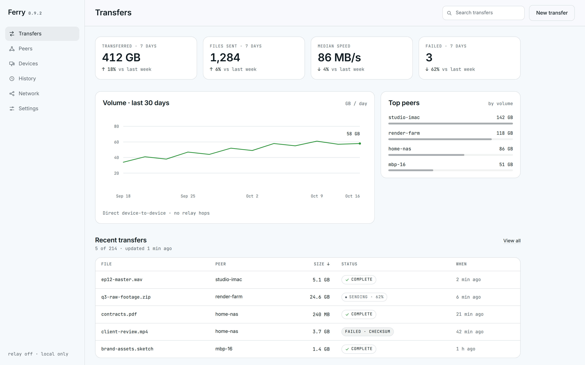
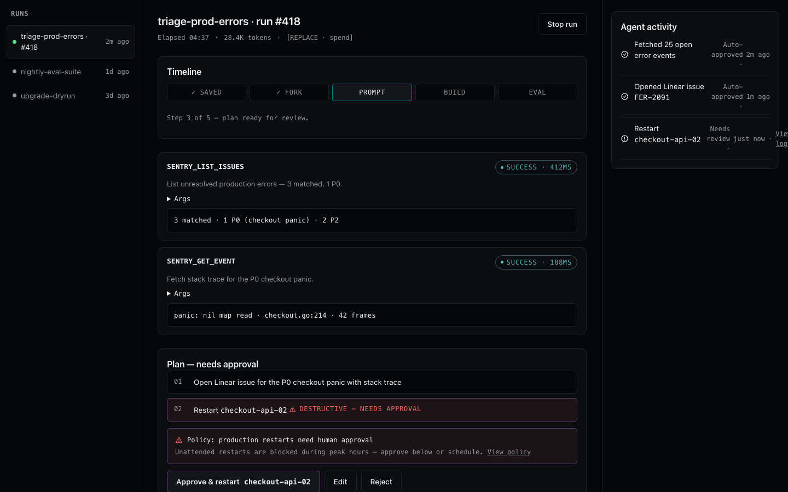

# Design Studio

**A design skill for coding agents.** Hand it a brief; get back a polished, self-contained HTML artifact — a landing page, app prototype, dashboard, or slide deck — that opens in any browser with no build step and no runtime dependencies.

[](LICENSE)

**Live Landing Page:** [itsd0.github.io/design-studio-skill](https://itsd0.github.io/design-studio-skill/) · **Demos:** [Landing](https://itsd0.github.io/design-studio-skill/demo/landing.html) · [Dashboard](https://itsd0.github.io/design-studio-skill/demo/dashboard.html) · [Agent run](https://itsd0.github.io/design-studio-skill/demo/agent.html) · [Slide Deck](https://itsd0.github.io/design-studio-skill/demo/deck.html)


The method, in one line: capture the brief → fix the brand in a `DESIGN.md` contract → pick one of eight flagship art directions → plan before pixels → build from an architectural seed → pass the anti-slop & WCAG contrast gates → deliver one `index.html` you can open, ship, print to PDF, or screenshot.

## Install

Design Studio is a standard [Agent Skills](https://agentskills.io) skill — one install works for OpenCode, Claude Code, Codex, Cursor, and many more agents.

**Agent Skills installer (any supported agent):**

```bash
npx skills add itsd0/design-studio-skill -g
```

**OpenCode — plain git:**

```bash
git clone --depth 1 https://github.com/itsd0/design-studio-skill ~/.config/opencode/skills/design-studio
```

**No git, no node (macOS / Linux / WSL):**

```bash
curl -fsSL https://raw.githubusercontent.com/itsd0/design-studio-skill/main/install.sh | sh
```

**Windows (PowerShell):**

```powershell
git clone --depth 1 https://github.com/itsd0/design-studio-skill "$env:USERPROFILE\.config\opencode\skills\design-studio"
```

Restart your agent afterwards. `install.sh` honors `SKILLS_DIR` and `XDG_CONFIG_HOME` if your skills live elsewhere.

## Use it

Just ask:

- "Design a landing page for a local-first file transfer tool."
- "Prototype a dashboard for a homelab."
- "Design an approval screen for an incident-triage agent."
- "Build a six-slide pitch deck as a single HTML file."
- "Review this index.html against the quality gates and fix what fails."

The agent writes a real `index.html`, runs the linter, and iterates until it passes.

## Demo

Three artifacts built from one brief, each a single self-contained file — [`demo/landing.html`](demo/landing.html), [`demo/dashboard.html`](demo/dashboard.html), and [`demo/deck.html`](demo/deck.html) — plus an agent run-detail demo, [`demo/agent.html`](demo/agent.html), and the brand contract they were built from, [`demo/design.md`](demo/design.md):






<p>
  
  
</p>

The deck is keyboard, wheel, and touch navigable — counter, progress bar, dots, print-to-PDF styles, and a self-contained navigation runtime included. All three demo files pass the linter with zero findings.

## What's new in v1.3.1 (Agent-UX quality pass)

- **Run controls** — every run view carries Stop/Cancel plus elapsed time, tokens, and cost (`[data-run]` + `[data-run-control="stop"]`; P0 `run-missing-stop`).
- **Named destructive approvals** — the approve button names its target (`Approve & restart checkout-api-02`), uses a neutral danger-tinted treatment instead of green, and keeps Reject equally weighted (P0 `destructive-approve-unnamed`).
- **Timeline states** — done `✓` muted, current accent + `aria-current="step"`, pending muted, connector lines, horizontal-scroll on mobile.
- **Craft details** — muted success pills (accent ≤ 2 uses; P1 `accent-overuse`), Args + output preview on every active tool call (P1 `tool-call-missing-output`), numbered full-border plan steps, icon + timestamp activity feed, sticky mobile approval bar, wider 1440px columns, thread view in `demo/agent.html`.

## What's new in v1.3.0 (Agent-UX artifact kind)

- **New `agent` artifact kind** — `thread`, `run-detail`, `approval`, `activity` screens for AI-agent products (`SKILL.md` Brief/Plan/Build + `references/agent-ux.md` contracts).
- **Agent seeds & patterns** — `assets/agent-seed.html` (runs sidebar + thread pane + inspector, 920px breakpoint) and `assets/agent-ux-patterns.html` (tool-call card, streaming, plan approval, guardrails, activity feed, run DAG, eval receipt, all states).
- **Agent lint gates** — `scripts/lint.py` enforces `tool-call-missing-status` (P0), `destructive-without-approval` (P0), and `stream-missing-aria-live` (P1) on pages with `data-artifact="agent"`.
- **Live demo** — [`demo/agent.html`](demo/agent.html): incident-triage run with step timeline, tool calls, guardrail, plan approval, and activity feed.

## What's new in v1.2.0 (2025–2026 Flagship Architecture)

- **8 curated flagship directions** — added dark-native engineering presets (`dark-structural-grid`, `neo-brutalist-terminal`, `atmospheric-craft-dark`) with obsidian canvases, exposed `1px` hairline grids, dual-tone headlines (`.tone-muted`, `.tone-block`), and `--accent-on` button ink safety.
- **High-craft schematic primitives** — `.bento-hairline` (gapless `1px` cells), `.bento-visual` (inline SVG latency gauges, isometric volume cubes, `FORK → BUILD → EVAL` DAG trees, wireframe globes), `.app-window` (multi-pane studio/runtime workspace), and `.index-showcase` (numbered `01`–`04` tab matrices).
- **Visual craft lint gate** — `scripts/lint.py` now enforces `missing-visual-craft` on multi-section landing pages and evaluates inline SVG schematics as unified accent moments.

## What's new in v1.1.0

- **Linter v2** — computed WCAG contrast for the core token pairs, static accessibility checks (`lang`, `alt`, control labels, zoom, focus, heading structure), and `--json` output. New self-tests in `tests/` keep the shipped seeds and demos clean.
- **Four new references** — [`motion.md`](references/motion.md) (durations, easing, reduced-motion), [`ux-flows.md`](references/ux-flows.md) (loading / empty / error states, microcopy), [`data-viz.md`](references/data-viz.md) (chart craft), [`ui-patterns.md`](references/ui-patterns.md) (component contracts).
- **Three new seeds** — `dashboard-seed.html` (rail, KPI row, SVG chart, table), `mobile-seed.html` (device frame), and `ui-patterns.html` (paste-ready component states); the section library grew to 11 blocks with schematic bentos, pricing, and prose.
- **Workflow upgrades** — experience dials (density / expressiveness / motion) captured at brief time, a review mode for audits, and a verify-with-screenshot step.

## What's inside

| Path | Purpose |
|---|---|
| `index.html` | Official Design Studio flagship landing page (live on GitHub Pages) |
| `SKILL.md` | The workflow the agent follows + non-negotiables |
| `references/design-md.md` | Brand contract: section order, standard token names, experience dials |
| `references/directions.md` | 8 curated visual directions (2025–2026 flagship dark + light palettes, fonts) |
| `references/artifact-contract.md` | Output rules: layout, imagery, dark mode, dashboards, mobile, exports |
| `references/deck-contract.md` | Deck mode: slide themes, rhythm, navigation runtime |
| `references/quality-gates.md` | Anti-slop + craft rules, WCAG 2.2 checklist, P0/P1/P2 gates |
| `references/motion.md` | Durations, easing curves, choreography, reduced-motion recipes |
| `references/ux-flows.md` | Loading / empty / error states, microcopy, navigation models |
| `references/data-viz.md` | Chart selection, axis and label craft, inline-SVG conventions |
| `references/ui-patterns.md` | Overlay ladder, component contracts, state machine |
| `references/agent-ux.md` | Agent screens: tool-call card, streaming, plan approval, guardrails, activity feed, run DAG, eval receipt |
| `assets/design-md.template.md` | Starter brand contract |
| `assets/prototype-seed.html` | Page/app seed: tokens + hairline bento + studio window + pricing/prose blocks |
| `assets/dashboard-seed.html` | Dashboard seed: rail, topbar, hairline KPI row, SVG chart, table |
| `assets/mobile-seed.html` | Mobile seed: device frame, status bar, tab bar |
| `assets/agent-seed.html` | Agent seed: runs sidebar, thread/run pane, inspector |
| `assets/agent-ux-patterns.html` | Paste-ready agent patterns (tool call → eval receipt) |
| `assets/ui-patterns.html` | Paste-ready component states (buttons → table toolbar) |
| `assets/section-skeletons.html` | 11 paste-ready sections (hero-stage, schematic bentos, indexed showcase, pricing, CTA…) |
| `assets/deck-seed.html` | Deck seed: themes, chrome, nav runtime, print CSS |
| `scripts/lint.py` | Anti-slop + a11y + contrast linter (fails on P0, advises on P1/P2) |
| `tests/run_tests.py` | Self-tests: rule fixtures + shipped artifacts stay clean |
| `demo/` | Finished example artifacts + the DESIGN.md behind them |
| `install.sh` | One-line installer |

## The linter

```bash
python3 scripts/lint.py index.html
```

Exit code `1` means at least one must-fix (P0) finding. Works on any single-file HTML artifact. It catches the standardized AI-slop tells — purple/indigo defaults, two-stop "trust" gradients, emoji iconography, left-accent cards, invented metrics, filler copy, broken deck themes — and now also:

- computes **WCAG contrast** for the core token pairs (foreground, muted, and accent against the surfaces) per theme and prints the ratios;
- checks the **accessibility statics**: `lang`, `alt`, control labels, zoom blockers, focus removal, heading structure;
- speaks `--json` for review reports:

```bash
python3 scripts/lint.py --json index.html
```

## Quality gates, in one breath

One token block; one accent with a hard budget; a display face bound to the direction, never the default; measured contrast instead of vibes; loading, empty, and error states on anything stateful; no `scrollIntoView`; a 920px reflow that actually works; decks that alternate light/dark with a nav runtime that respects iframes. The full checklist — including the WCAG 2.2 AA pass — lives in [`references/quality-gates.md`](references/quality-gates.md).

## Requirements

- Python 3 — for the linter only
- The artifacts themselves are plain HTML/CSS/JS: no dependencies, no build step

## Credits

Portions of this skill — the artifact linter, the deck runtime, and parts of the design method — are adapted from the [open-design](https://github.com/nexu-io/open-design) project, licensed under the Apache License 2.0.

## License

[MIT](LICENSE)
