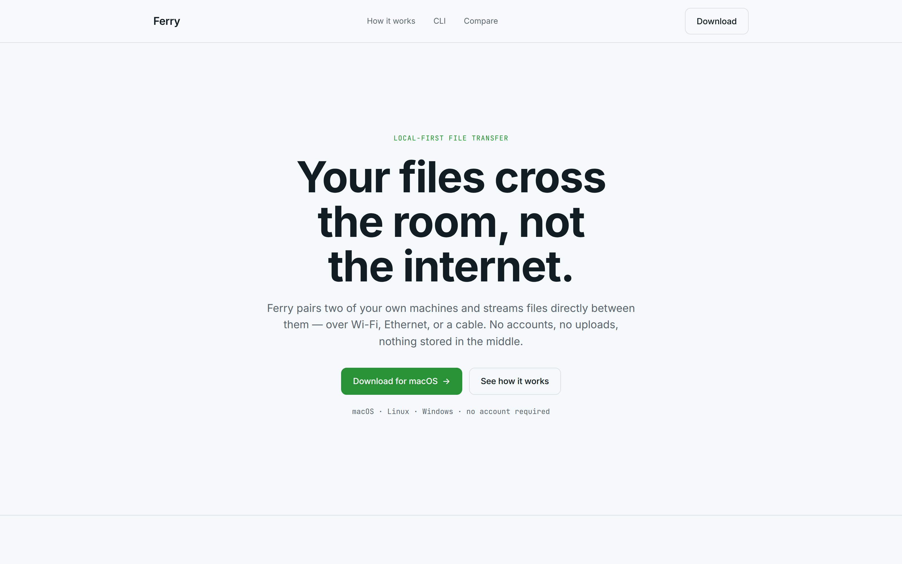
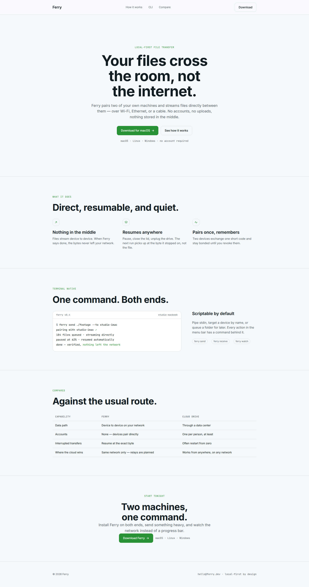
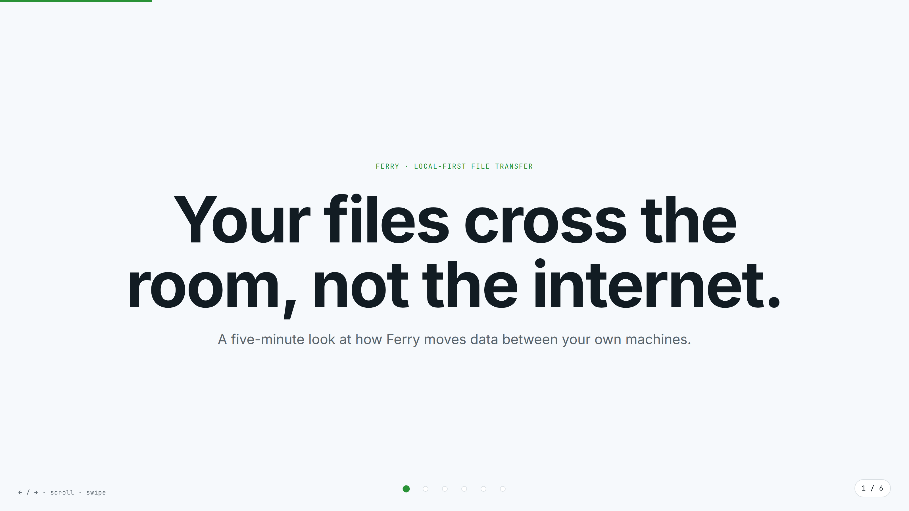
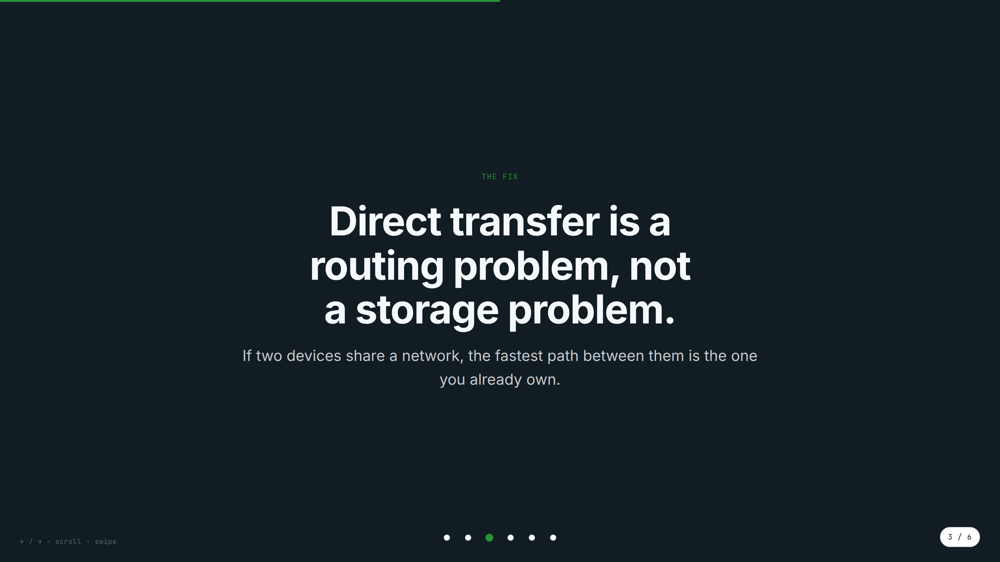

# Design Studio

**A design skill for coding agents.** Hand it a brief; get back a polished, self-contained HTML artifact — a landing page, app prototype, dashboard, or slide deck — that opens in any browser with no build step and no runtime dependencies.

[](LICENSE)



The method, in one line: capture the brief → fix the brand in a `DESIGN.md` contract → pick one of five art directions → plan before pixels → build from a seed → pass the anti-slop gates → deliver one `index.html` you can open, ship, print to PDF, or screenshot.

## Install

Design Studio is a standard [Agent Skills](https://agentskills.io) skill — one install works for OpenCode, Claude Code, Codex, Cursor, and many more agents.

**Agent Skills installer (any supported agent):**

```bash
npx skills add itsd0/design-studio-skill -g
```

**OpenCode — plain git:**

```bash
git clone --depth 1 https://github.com/itsd0/design-studio-skill ~/.config/opencode/skills/design-studio
```

**No git, no node (macOS / Linux / WSL):**

```bash
curl -fsSL https://raw.githubusercontent.com/itsd0/design-studio-skill/main/install.sh | sh
```

**Windows (PowerShell):**

```powershell
git clone --depth 1 https://github.com/itsd0/design-studio-skill "$env:USERPROFILE\.config\opencode\skills\design-studio"
```

Restart your agent afterwards. `install.sh` honors `SKILLS_DIR` and `XDG_CONFIG_HOME` if your skills live elsewhere.

## Use it

Just ask:

- "Design a landing page for a local-first file transfer tool."
- "Prototype a dashboard for a homelab."
- "Build a six-slide pitch deck as a single HTML file."
- "Review this index.html against the quality gates and fix what fails."

The agent writes a real `index.html`, runs the linter, and iterates until it passes.

## Demo

Two artifacts built from one brief, each a single self-contained file — [`demo/landing.html`](demo/landing.html) and [`demo/deck.html`](demo/deck.html) — plus the brand contract they were built from, [`demo/design.md`](demo/design.md):



<p>
  
  
</p>

The deck is keyboard, wheel, and touch navigable — counter, progress bar, dots, print-to-PDF styles, and a self-contained navigation runtime included.

## What's inside

| Path | Purpose |
|---|---|
| `SKILL.md` | The workflow the agent follows + non-negotiables |
| `references/design-md.md` | Brand contract: section order, standard token names |
| `references/directions.md` | 5 curated visual directions (palettes, fonts) |
| `references/artifact-contract.md` | Output rules: layout, imagery, dashboards, mobile, exports |
| `references/deck-contract.md` | Deck mode: slide themes, rhythm, navigation runtime |
| `references/quality-gates.md` | Anti-slop + craft rules, P0/P1/P2 review checklist |
| `assets/design-md.template.md` | Starter brand contract |
| `assets/prototype-seed.html` | Page/app seed: tokens + class system |
| `assets/section-skeletons.html` | 8 paste-ready sections (hero, features, stats, quote, CTA…) |
| `assets/deck-seed.html` | Deck seed: themes, chrome, nav runtime, print CSS |
| `scripts/lint.py` | Anti-slop linter (fails on P0, advises on P1/P2) |
| `demo/` | Finished example artifacts + the DESIGN.md behind them |
| `install.sh` | One-line installer |

## The linter

```bash
python3 scripts/lint.py index.html
```

Exit code `1` means at least one must-fix (P0) finding. Works on any single-file HTML artifact. It catches the standardized AI-slop tells: purple/indigo defaults, two-stop "trust" gradients, emoji iconography, left-accent cards, invented metrics, filler copy, missing deck themes, and more.

## Quality gates, in one breath

One token block; one accent with a hard budget; a display face bound to the direction, never the default; no `scrollIntoView`; a 920px reflow that actually works; decks that alternate light/dark with a nav runtime that respects iframes. The full checklist lives in [`references/quality-gates.md`](references/quality-gates.md).

## Requirements

- Python 3 — for the linter only
- The artifacts themselves are plain HTML/CSS/JS: no dependencies, no build step

## Credits

Portions of this skill — the artifact linter, the deck runtime, and parts of the design method — are adapted from the [open-design](https://github.com/nexu-io/open-design) project, licensed under the Apache License 2.0.

## License

[MIT](LICENSE)
